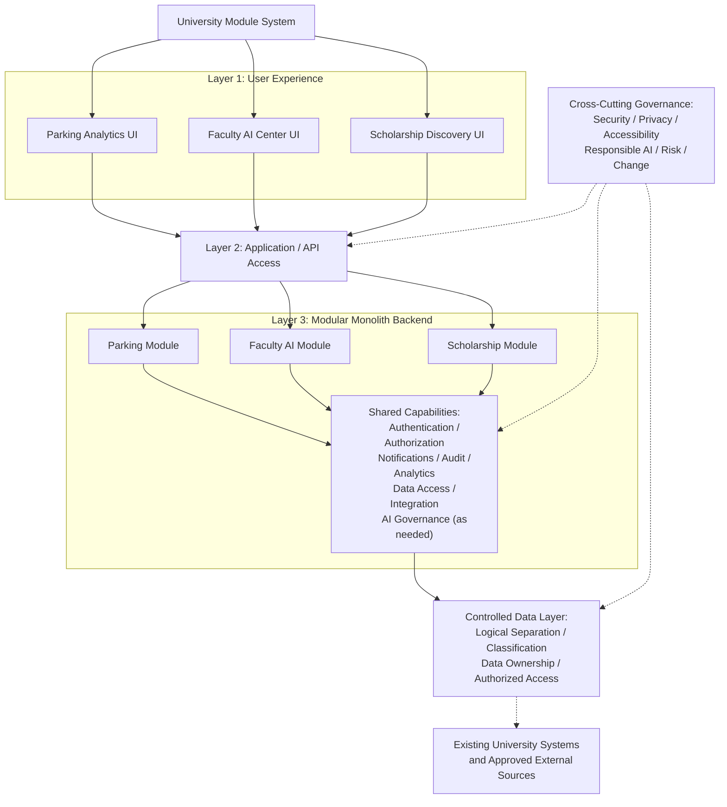

# University Module System — Architecture Overview

## 1. Purpose

The University Module System is a proposed modular software platform intended to improve access to University services, simplify workflows, and support consistent technical practices across multiple products.

The architecture follows a proposed modular monolith approach, with distinct product modules supported by reusable shared capabilities and controlled data access.

The system will be developed incrementally as product teams validate requirements, build prototypes, and identify technical dependencies.

## 2. Product Modules

The portfolio currently includes three product areas, with the following working concepts:

- **Parking Analytics:** Parking information, availability, and related analytics or services.
- **Faculty AI Center of Excellence:** Approved AI tools, resources, and functionality for faculty and other authorized users.
- **Scholarship Discovery:** Scholarship information, discovery, and potential personalized assistance.

Product names, features, and technical requirements remain subject to validation by the development teams.

Each module will maintain responsibility for its own business logic and functionality while using common architectural standards and shared capabilities where appropriate.

## 3. Shared Architecture

The University Module System will use a modular monolith architecture with multiple front-end interfaces and a common application foundation.

### Architectural Layers

**Layer 1: User Experience**
- Provide distinct interfaces tailored to each product's users and functionality.
- Maintain consistent usability, accessibility, and security expectations.
- Support public or authenticated access according to product requirements.

**Layer 2: Application / API Access**
- Route requests between front-end interfaces and appropriate business modules.
- Support request validation, authentication integration, and access enforcement.
- Maintain controlled interfaces for application functionality and approved integrations.

**Layer 3: Business Services**
- Organize product-specific functionality into distinct modules.
- Maintain clear boundaries between business rules, workflows, and responsibilities.
- Reuse shared capabilities without introducing unnecessary dependencies.

**Shared Services Layer**
- Authentication and authorization.
- Notifications and audit logging.
- Analytics and reporting.
- Controlled data access and integration.
- AI governance and integration capabilities where appropriate.

**Controlled Data Layer**
- Support logically separated product data and approved institutional information sources.
- Apply data classification, ownership, authorization, and protection requirements.
- Maintain authoritative information sources and minimize unnecessary duplication.
- Support appropriate retention, backup, and data lifecycle management.

**Cross-Cutting Governance**
- Apply security, privacy, accessibility, responsible AI, and compliance requirements throughout the system.
- Establish consistent architecture standards, risk management, and change control.
- Review significant changes affecting shared capabilities, integrations, or protected information.

## 4. Architecture Diagram

The following diagram represents the proposed logical architecture. It does not prescribe specific technologies, physical infrastructure, or finalized product functionality.

The shared capabilities provide common functionality to the product modules. Business modules remain responsible for enforcing their own domain-specific rules and permissions.

The controlled data layer represents logical protection boundaries rather than a requirement for separate physical databases.

## 5. Architectural Boundaries and Governance

- Product teams are responsible for developing and maintaining their assigned modules.
- The CTO/CIO coordinates the portfolio-level architecture and shared technical direction.
- The Security/AI Architect supports security, privacy, data protection, and responsible AI design.
- Shared capabilities and cross-module integrations require appropriate architectural coordination and review.
- Institutional data access must be authorized by the appropriate University data owners.
- Security, accessibility, and data protection should be considered throughout development.
- Prototypes should use synthetic or approved public data unless access to protected information has been explicitly authorized.

The architecture follows ten key principles:

1. Privacy by Design
2. Data Minimization
3. Least Privilege Access
4. Single Source of Truth
5. Modular Monolith
6. User Experience Separation
7. Compliance by Design
8. Shared Capabilities
9. Controlled Data Access
10. Maintainability and Change Management

## 6. Future Development

The architecture will evolve as teams validate their products, identify data requirements, and develop technical prototypes.

Detailed documentation will be organized into the following planned files:

- `principles.md` — Architecture principles and design expectations.
- `shared-capabilities.md` — Reusable technical services and responsibilities.
- `data-architecture.md` — Data organization, ownership, classification, and access.
- `security-governance.md` — Security, privacy, accessibility, and AI governance.
- `product-modules.md` — Working product concepts, boundaries, and dependencies.

Significant architectural decisions and revisions will be maintained in GitHub as requirements become clearer.

## 7. Current Status

**Architecture Stage:** Proposed Architecture / Solution Validation

**Current Focus:**
- Defining module boundaries and shared capabilities.
- Establishing security, data governance, and accessibility expectations.
- Identifying potential integrations and architectural dependencies.
- Supporting product teams as they develop and validate prototypes.

**Pending:**
- Confirmation of product functionality and requirements.
- Validation of data sources, ownership, and integration feasibility.
- Selection of implementation technologies and database structures.
- Technical design review with product IT/AI Leads.
- Evaluation and refinement of security and accessibility requirements.
