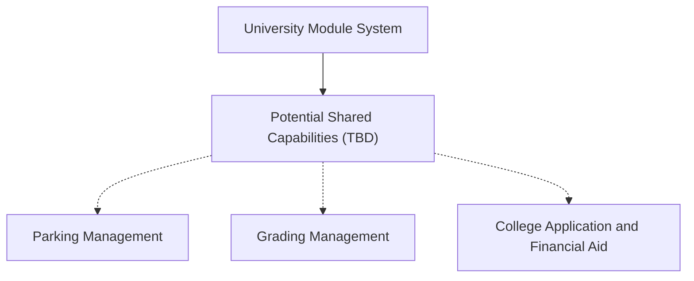

**University Module System - Architecture Overview**

**1. Purpose**
   
   The University Module System is a modular software platform intended to support and streamline university administrative processes. The system consists of three distinct modules or products that may share common technical capabilities, data structures, and architectural standards. The architecture will be developed incrementally, over the course of the semester, as product teams refine their proposed solutions and identify system requirements.
   
**2. Product Modules**

   The portfolio currently consists of three product modules:
   - Parking Management
   - Grading Management
   - Application and Financial Aid Assistance
   Each product module will maintain its own functional responsibilities while following common architectural standards when possible/appropriate.

**3. Shared Architecture**

   The system will follow a modular architecture that allows individual products to operate independently while reusing shared capabilities when beneficial. The shared platform will provide a foundation for technical capabilities and controlled interactions between modules. This structure is intended to reduce unnecessary duplication while preventing individual product teams from unintentionally modifying shared components or affecting other modules.
   Shared capabilities still need to be explored.
   
**4. Architecture Diagram (Basic!)**

  (shared platform represents conceptual architectural foundation, dashed lines represent potential shared capabilities that need further investigation)

**5. Architectural Boundaries and Governance**

  Each product team will be primarily responsible for developing and maintaining its assigned module. Shared components and cross-product interfaces will be subject to additional coordination and architectural review.
  The architecture will follow these guiding principles (add principles!)
   
   
**6. Future Development**

   The architecture will be refined as product teams learn more information about their products and architecture diagrams, technical documentation, and architectural decisions will be updated and maintained within the GitHub repository as the system evolves.
   
**7. Current Status**
   Architecture Stage: Initial Concept
   Current Focus: Establishing modular boundaries, defining shared architectural principles, and identifying potential common domains and capabilities.
   Pending: General solution concepts, additional product requirements, identification of shared entities, and technical decisions from the product product development teams - specifically the IT/AI leads.
   
